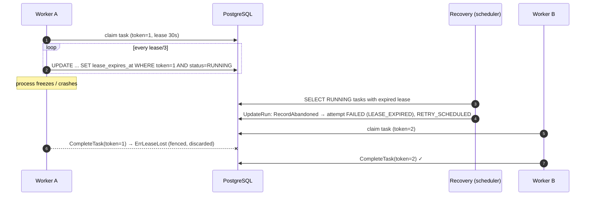

# Concurrency and resilience

## Guarantees — stated precisely

| Property | GoFlow guarantees | How |
|---|---|---|
| State durability | Every decision is committed before it is acted on | Single transaction per command (`UpdateRun`) |
| Task delivery | **At least once** | Lease + recovery; a task whose outcome was not stored runs again |
| Task processing (state) | **Exactly once per lease**: an outcome is applied at most once | Fencing token checked under row lock |
| Handler side effects | **Not** exactly once | Impossible without the external system's cooperation; handlers get a stable `IdempotencyKey` (`execution/kind/step`) to deduplicate |
| Client requests | Idempotent `POST` with `Idempotency-Key` | Stored response replay + unique `(tenant_id, idempotency_key)` on executions |

GoFlow never claims exactly-once execution. In the happy path a task runs
once (verified by `TestManyWorkersExecuteEachTaskOnce`: 60 executions × 4
steps on 4 competing workers, every task executed exactly once); after a
crash, timeout or lost report it may run again with the same idempotency key.

## Claiming tasks: `FOR UPDATE SKIP LOCKED`

```sql
WITH candidates AS (
  SELECT t.id FROM tasks t JOIN executions e ON e.id = t.execution_id
  WHERE t.status IN ('READY','RETRY_SCHEDULED') AND t.run_at <= now()
    AND t.handler = ANY($handlers) AND e.status IN ('RUNNING','WAITING','COMPENSATING')
  ORDER BY t.run_at, t.id LIMIT $free_slots
  FOR UPDATE OF t SKIP LOCKED)
UPDATE tasks SET status='RUNNING', attempts=attempts+1, lease_owner=$worker,
       lease_token=lease_token+1, lease_expires_at=now()+$lease ...
-- + INSERT task_attempts in the same statement
```

* Workers never block each other and never receive the same row
  (`TestConcurrentClaimsNeverOverlap`: 16 claimers, 100 tasks, no overlap).
* The partial index `tasks_runnable_idx (run_at) WHERE status IN (...)`
  keeps polling cheap regardless of history size.
* A worker only claims handlers it has registered, so heterogeneous worker
  fleets are possible.

## Leases, heartbeats and fencing



* The **fencing token** (`lease_token`) is incremented on every claim. Results
  are accepted only if the task is still `RUNNING` with the reporter's token,
  checked inside the locked transaction.
* The heartbeat returns which leases are still owned; tasks no longer owned
  (cancelled, reclaimed) get their context cancelled with cause `lease lost`
  and their result is discarded without being reported.
* If the database is unreachable for longer than a lease, the worker cancels
  all its tasks: another worker may already be running them.
* Lease times are computed with the database clock (`now()`), so worker
  clock skew does not matter.

## Single write path and lock ordering

All execution mutations go through `postgres.Store.UpdateRun`:

1. `SELECT ... FROM executions WHERE id=$1 FOR NO KEY UPDATE`
2. `SELECT ... FROM tasks WHERE execution_id=$1 ORDER BY kind, position FOR UPDATE`
3. `SELECT clock_timestamp()` — the time used by the domain
4. apply the domain command, then persist all changes with one `pgx.Batch`

Consequences:

* Concurrent completions of parallel branches, cancellations, pauses and
  recoveries of the same execution are **serialized**; none can observe a
  half-applied decision (`TestParallelCompletionsOfOneExecution`,
  `TestCancelRacingWithCompletion`).
* The order is always execution → tasks, so two `UpdateRun` calls cannot
  deadlock each other. Claims use `SKIP LOCKED` and never wait on these
  locks. `FOR NO KEY UPDATE` (not `FOR UPDATE`) lets inserts referencing the
  execution (attempt rows, events) proceed concurrently.
* Serialization failures and deadlocks (40001/40P01) are retried up to 3
  times by `inTx`.

## Why there is no Transactional Outbox

GoFlow does not publish events to an external broker in v1: the history
(`execution_events`) is written in the same transaction as the state change,
and workers learn about work by querying the same database. There is no dual
write, so an outbox would add a relay process with nothing to relay. If
external publication (webhooks, Kafka) is added, an outbox table written by
`persistChanges` plus a relay using the same `SKIP LOCKED` pattern is the
intended design (ADR-0002).

## Worker internals (Go concurrency)

* **Semaphore / backpressure**: a buffered channel of size `Concurrency`. The
  poll loop acquires one slot (blocking), then opportunistically more, and
  claims exactly as many tasks as slots it holds. A saturated worker stops
  claiming instead of queueing work in memory.
* **Goroutine per task** bounded by the semaphore; a `sync.WaitGroup` tracks
  in-flight tasks for the drain.
* **Context tree**: tasks run under a context detached from the shutdown
  signal (`context.WithoutCancel`), so a SIGTERM stops polling but lets
  tasks finish; after `ShutdownTimeout` they are cancelled with cause
  `errShutdown` and reported as retryable. Each task has a
  `context.WithCancelCause` (lease lost vs shutdown) and a
  `context.WithTimeout` (step timeout).
* **Mutex-protected in-flight map** (`sync.Mutex`) shared by executor
  goroutines and the heartbeat goroutine. A heartbeat only judges tasks that
  were part of its snapshot, so a task claimed between snapshot and response
  is not cancelled by mistake.
* **Panics** in handlers are recovered and reported as `PANIC` (not retried);
  HTTP handler panics become 500s.
* **Reporting** retries transient storage errors with backoff on a
  context detached from cancellation; if it still fails, the lease expires
  and recovery retries the task.
* Other shared state: the API key cache uses `sync.RWMutex`; the rate
  limiter's buckets use `sync.Mutex`; `handler.Registry` uses `sync.RWMutex`.

## Failure scenarios

| Scenario | Behaviour | Test |
|---|---|---|
| Worker process crashes mid-task | Lease expires, recovery marks attempt `LEASE_EXPIRED`, task retried by another worker; late result fenced | `TestCrashedWorkerTaskIsRecovered` |
| Engine restart / SIGTERM | Drain up to `GOFLOW_SHUTDOWN_TIMEOUT`, then abort as `WORKER_SHUTDOWN` (retryable); new instance continues from the database | `TestEngineRestartResumesWork`, `TestShutdownDrainsInFlightTasks` |
| All DB connections killed | pgx pool reconnects; failed reports are retried, otherwise recovered via lease expiry; all executions complete | `TestDatabaseConnectionLoss` |
| Claim errors (DB down) | Poll loop backs off exponentially (max 30s), never crashes | `TestClaimErrorsBackOffWithoutCrashing` |
| Duplicate delivery | Same `IdempotencyKey` on every attempt | `TestRedeliveryKeepsIdempotencyKey`, example simulators |
| Duplicate client request | Response replay; DB unique key on executions | `TestStartIsIdempotent` (10 concurrent requests → 1 execution) |
| Timeout | Context deadline → `TIMEOUT`, retried; handler ignoring the deadline still counts as timeout | `TestTimeoutPanicAndDeadLetterQueue`, worker unit tests |
| Cancel racing completion | Exactly one wins per execution; states consistent | `TestCancelRacingWithCompletion` |
| Cancel while handler runs | Task fenced; handler context cancelled at next heartbeat | `TestCancelStopsRunningHandler` |
| Compensation fails | Saga stops, execution `FAILED`, remaining compensations left `PENDING` | `TestCompensationFailureStopsSagaAndFails` |
| Broker failure | N/A — no broker in v1 (ADR-0002) | — |
