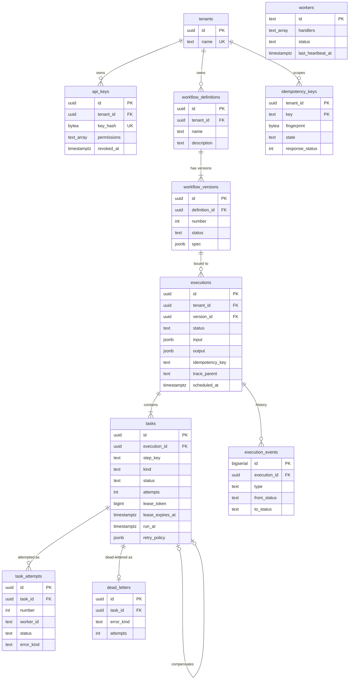

# Data model

Schema: [`migrations/0001_init.sql`](../../migrations/0001_init.sql). Migrations
are embedded in the binary, applied in order under an advisory lock, one
transaction per file, and checksummed (an edited, already-applied migration
is an error). `goflow migrate` applies them; `GOFLOW_AUTO_MIGRATE=true` does
it at startup.

## Notable constraints and indexes

| Object | Purpose |
|---|---|
| `workflow_versions_single_draft_idx` (partial unique) | At most one draft per workflow |
| trigger `workflow_versions_immutable` | Rejects UPDATE/DELETE of a `PUBLISHED` version even if application code regresses |
| `UNIQUE (tenant_id, idempotency_key)` on executions | Deduplicates concurrent starts |
| `UNIQUE (execution_id, kind, step_key)` on tasks | One action and at most one compensation per step |
| `UNIQUE (task_id, number)` on attempts | Attempt history cannot fork |
| `UNIQUE task_id` on dead_letters | A task is dead-lettered once |
| `tasks_runnable_idx (run_at) WHERE status IN ('READY','RETRY_SCHEDULED')` | Hot path for claims and persistent retry scheduling |
| `tasks_lease_idx (lease_expires_at) WHERE status = 'RUNNING'` | Recovery of abandoned leases |
| `executions_due_idx (scheduled_at) WHERE status = 'PENDING'` | Scheduled executions |
| `(tenant_id, created_at DESC, id DESC)` indexes | Keyset pagination per tenant |
| `CHECK` constraints on every status column | The database rejects unknown states |

Every tenant-owned table carries `tenant_id`, and every API query filters by
it (see [security](security.md)).

## What is stored where

* **Execution input/output, task input/output** — `jsonb`. Task input is the
  envelope built when the task becomes ready (workflow input, params,
  dependency outputs), so a retry sees exactly the same input.
* **Retry policy and compensation spec** — copied onto each task at creation,
  so in-flight executions are unaffected by later definition versions.
* **Worker state** — `workers` keeps id, handlers, concurrency and last
  heartbeat. The `handlers` column is the catalog checked when publishing.
  Workers silent for 2 minutes are marked `STOPPED` by housekeeping.
* **Schedules** — `executions.scheduled_at` and `tasks.run_at`; no timers in
  memory.
