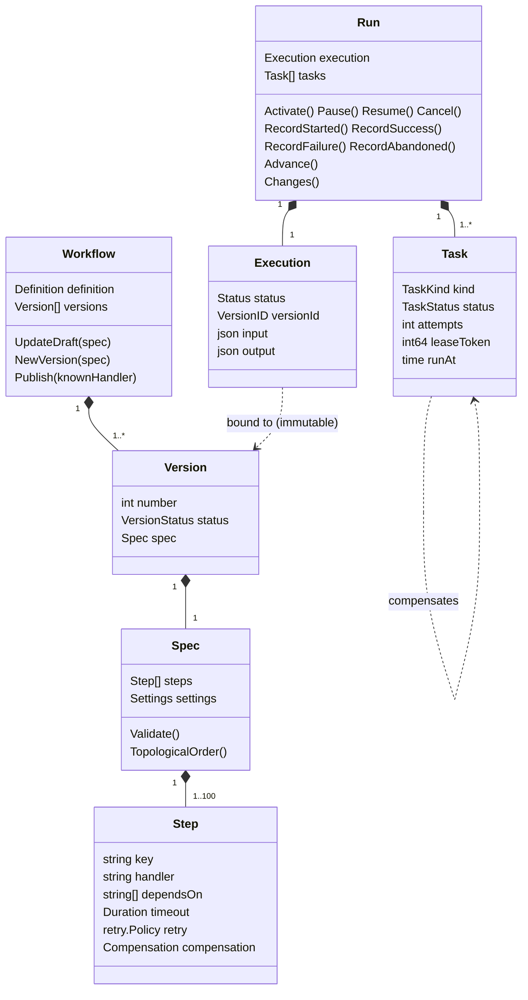
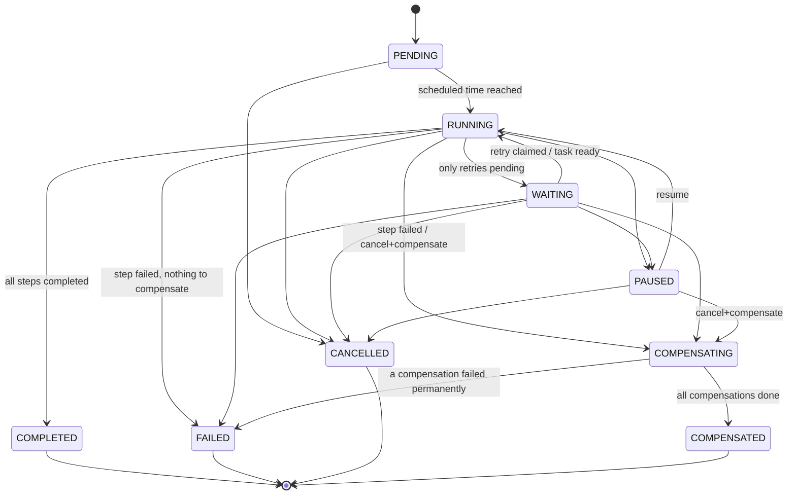
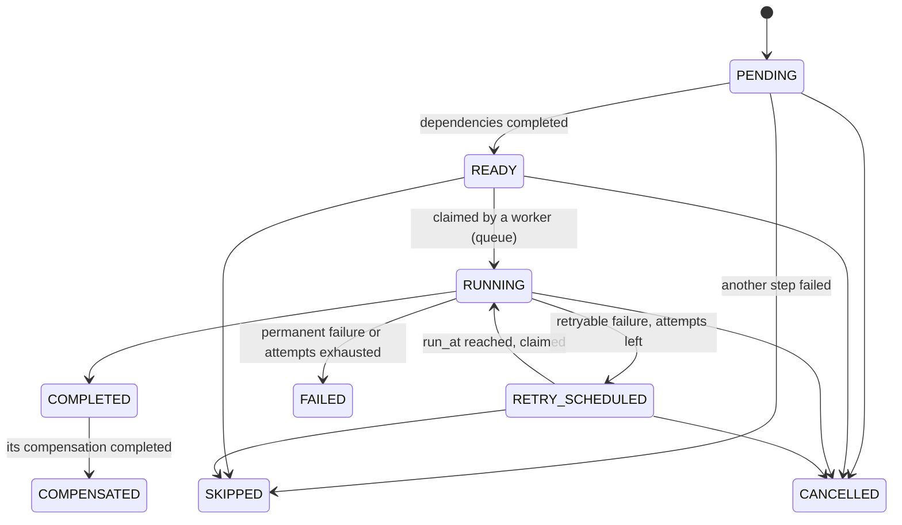
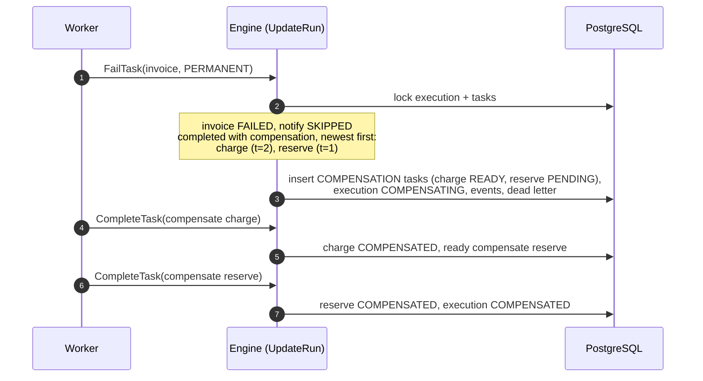
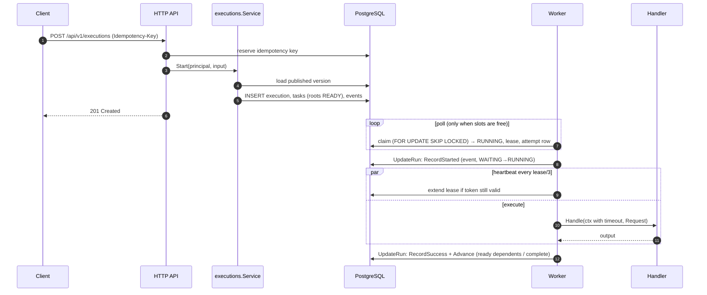

# Execution model

## Domain model

`Run` is the aggregate root of execution: every command loads the execution
and all its tasks with row locks, mutates them only through the state
machines, and returns a `Changes` set (changed/new tasks, events, attempt
results, dead letters) that the repository writes in the same transaction.

## Execution state machine

Any other transition returns `ErrInvalidTransition` (HTTP 409). The table is
defined once in `internal/domain/execution/status.go` and tested
exhaustively (every pair of states).

## Task state machine

`READY/RETRY_SCHEDULED → RUNNING` is the only transition performed outside
the aggregate: the task queue does it atomically while claiming (see
[concurrency](concurrency-and-resilience.md)).

## DAG progression

`Run.Advance` is idempotent and applies every decision implied by the
current task states:

1. If an action task is `FAILED`: not-yet-started actions become `SKIPPED`.
   If siblings are still `RUNNING`, wait — their outcome decides what must be
   compensated. Otherwise start compensation (or fail if there is nothing to
   compensate).
2. Every `PENDING` action whose dependencies are all `COMPLETED` becomes
   `READY`, limited by `settings.max_parallelism`. Its input envelope is
   built then: `{workflow_input, params, dependencies: {step: output}}`.
3. When every action is `COMPLETED` the execution completes with output
   `{step_key: output}`.
4. `RUNNING ↔ WAITING` reflects whether anything is runnable now or only
   retries are pending.

Cycles are rejected at definition time (Kahn's algorithm, reporting the steps
involved), and tasks are stored in topological order.

## Retries and dead letter queue

Handlers return `handler.Permanent(err)` for non-retryable failures; any
other error is retryable. The worker classifies failures:

| Kind | Retried | Source |
|---|---|---|
| `RETRYABLE` | yes | ordinary handler error |
| `TIMEOUT` | yes | step timeout exceeded (context deadline) |
| `LEASE_EXPIRED` | yes | worker stopped heartbeating (crash) |
| `WORKER_SHUTDOWN` | yes | worker aborted the task after its drain timeout |
| `PERMANENT` | no | `handler.Permanent`, invalid input/output |
| `PANIC` | no | recovered panic (programming error) |

A retry sets `run_at = now + backoff(attempt)` with exponential growth,
`max_interval` cap and ± jitter, and the task becomes `RETRY_SCHEDULED`.
**No goroutine waits for it**: the claim query simply ignores tasks whose
`run_at` is in the future, so the schedule survives restarts. When retries
are exhausted or the failure is permanent, the task becomes `FAILED` and a
row is inserted in `dead_letters` in the same transaction
(`GET /api/v1/dead-letters`).

## Saga compensation

* Compensations are business operations (refund, release), not database
  rollbacks. They receive the original step's output
  (`Request.CompensatedOutput`) and the same input/params.
* They run **one at a time in reverse completion order**. Parallel branches
  completed at the same instant fall back to reverse topological order,
  which is still a valid reverse order for the DAG.
* Each compensation has its own retry policy and timeout; its state is
  persisted like any task, so a crash during compensation resumes where it
  stopped.
* If a compensation fails permanently (or exhausts retries) the saga stops,
  the execution becomes `FAILED` with both errors, and the remaining
  compensations stay `PENDING` for manual intervention — compensating a
  step that was never safely undone in order could be worse than stopping.
* `POST /executions/{id}/cancel` with `compensate: true` cancels running
  steps and compensates the completed ones.

## Pause and resume

Pausing stops new claims (claims require `RUNNING/WAITING/COMPENSATING`).
In-flight tasks finish and their results are recorded, but workflow-level
decisions are deferred: `Resume` calls `Advance`, which readies dependents,
completes, fails or starts compensation as appropriate.

## Scheduling

`scheduled_at` in the future keeps the execution `PENDING`. The scheduler
loop activates due executions (`status = 'PENDING' AND scheduled_at <= now()`)
every second on every API instance; activation re-checks the status under
the row lock, so concurrent schedulers activate each execution once.

## Sequence: starting and running an execution

