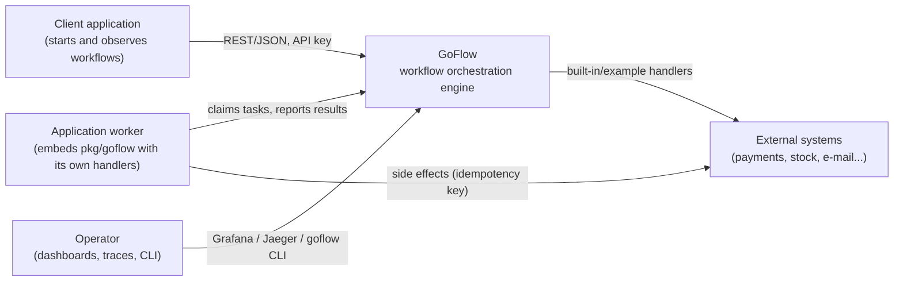
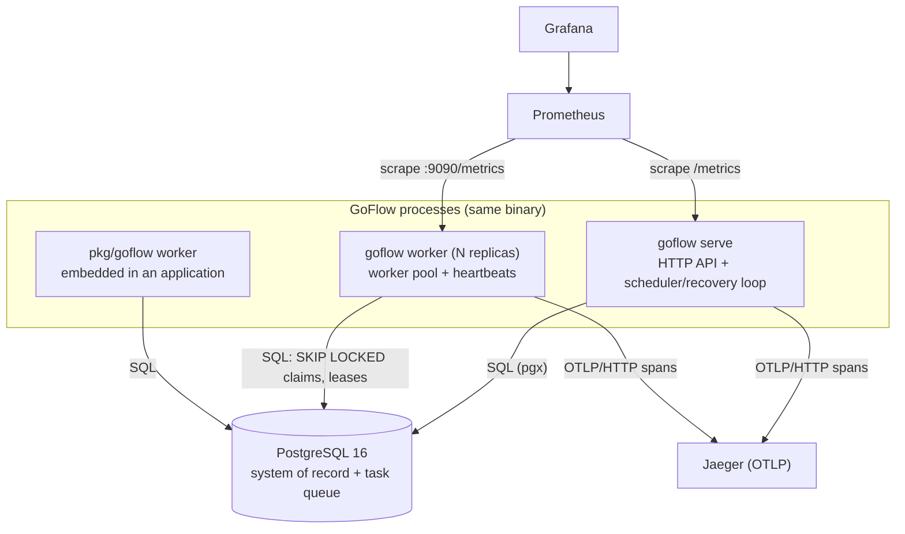
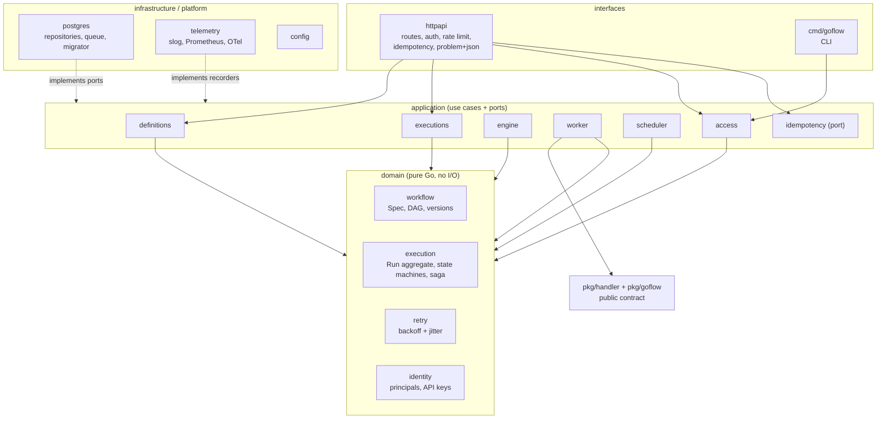

# Architecture overview

GoFlow is a **modular monolith** built with hexagonal (ports and adapters)
layering. One binary runs in three roles — `serve` (REST API + scheduler),
`worker` and `all` — and every role coordinates exclusively through
PostgreSQL. There is no in-memory state that a crash could lose.

## C4 — Level 1: system context



## C4 — Level 2: containers



## C4 — Level 3: components and dependency rule



Dependencies point inwards only. The domain imports nothing but the standard
library. Application packages declare the small interfaces they consume
(`definitions.Store`, `worker.Queue`, `engine.Recorder`...) and the
infrastructure satisfies them; `internal/app` is the only place where
concrete types meet.

## Bounded contexts

The eight contexts proposed initially were consolidated where splitting them
would only add indirection:

| Context | Package(s) | Notes |
|---|---|---|
| Workflow Definition | `domain/workflow`, `application/definitions` | Versioned DAG specs; published versions are immutable. |
| Workflow Execution + Task Execution + Compensation | `domain/execution`, `application/executions`, `application/engine` | One aggregate (`Run`): deciding what runs next, retries and saga compensation all need a consistent view of the execution **and all of its tasks**. Separate aggregates would require distributed coordination inside one database transaction. |
| Retry and Scheduling | `domain/retry`, `application/scheduler` | Backoff policy is a value object; scheduling is a due-time column (`run_at`, `scheduled_at`) polled from the database. |
| Worker Management | `application/worker`, `workers` table | Worker pool, leases, heartbeats, handler catalog. |
| Identity and Access | `domain/identity`, `application/access` | Tenants, API keys, permissions. |
| Observability | `platform/telemetry` | Cross-cutting; implements recorder ports. |

## Package layout

```text
cmd/goflow                 CLI and process entry point
internal/domain            entities, value objects, state machines (no I/O)
internal/application       use cases and the ports they need
internal/infrastructure    PostgreSQL adapters and migrator
internal/interfaces        HTTP API
internal/platform          config and telemetry
internal/app               composition root
internal/examples/orders   example handlers (opt-in)
pkg/handler                public handler contract (Handler, Registry, Permanent)
pkg/goflow                 public SDK to run a worker inside another application
migrations                 embedded SQL migrations
test/integration           PostgreSQL integration, concurrency and failure tests
```

## Process roles

| Command | Runs | Scales |
|---|---|---|
| `goflow serve` | HTTP API, scheduler (activation of scheduled executions, lease recovery, housekeeping, gauges) | Horizontally; every loop is safe to run on many instances. |
| `goflow worker` | Worker pool for the registered handlers, `/metrics` and `/health` on `:9090` | Horizontally; claims never overlap (`FOR UPDATE SKIP LOCKED`). |
| `goflow all` | Both, for local development | — |
| `pkg/goflow.RunWorker` | A worker with application-defined handlers | Like `goflow worker`. |

See also: [execution model](execution-model.md), [concurrency and
resilience](concurrency-and-resilience.md), [data model](data-model.md),
[security](security.md), [observability](observability.md) and the
[ADRs](../adr/).
